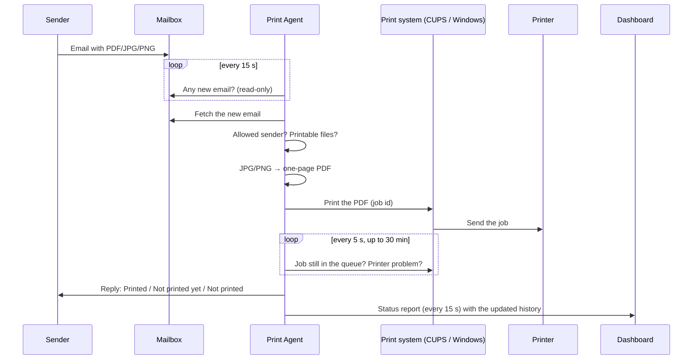

# Print Agent: complete application flow

How Print Agent works from setup to a printed page, how it reports status, and how
to connect it to your own dashboard. Section 8 is the contract a dashboard back end
must implement.

---

## 1. What it does

Anyone emails a PDF, JPG or PNG to a mailbox. Print Agent, running on a computer in
the office, picks the email up and prints the attachment on the office printer. It
then tells the sender whether it printed and reports the printer's status to a
dashboard.

```
Sender (anywhere) ──email + file──▶ Mailbox (e.g. Gmail)
                                        │  checked every 15 s (IMAP, read-only)
                                        ▼
                         Print Agent (office PC, Mac or Raspberry Pi)
                           │                       │
              print system │                       │ HTTPS, every 15 s
             (CUPS/Windows)▼                       ▼
                        Printer               Your dashboard
                     (USB or network)        (status, alerts)
                           │
                           └──▶ reply email to the sender: Printed / Not printed yet / Not printed
```

Print Agent is needed because the printer is on a private office network: nothing on
the internet can reach it. The agent sits inside that network and only makes
outgoing connections (to the mailbox, and to the dashboard).

## 2. Parts

| Part | What it is | Where it runs |
|---|---|---|
| **Print Agent** (`print-agent`) | One Go program, the only required part | A computer that stays on and can print to the printer: Windows, macOS, Linux or Raspberry Pi |
| **Mailbox** | Any IMAP mailbox with an app password (Gmail is easiest) | The mail provider |
| **Printer** | Any printer, any brand, that the computer can print to (USB or network) | The office |
| **Dashboard** (optional) | Your own dashboard, or the included `print-cloud` | A server with a public HTTPS address |

## 3. Setup flow

1. **Install** with one command:
   - Linux/macOS: `curl -fsSL https://raw.githubusercontent.com/vinayk-kumar/printer/main/install.sh | sh`
   - Windows: `irm https://raw.githubusercontent.com/vinayk-kumar/printer/main/install.ps1 | iex`
2. **The installer prepares the computer:**
   - Linux: installs CUPS if it is missing; for an HP USB printer that isn't set up, also HP's driver (HPLIP).
   - Windows: downloads SumatraPDF, which prints PDFs silently.
   - It then downloads the Print Agent binary for the computer's system.
3. **Four questions** (or flags such as `--printer`, `--email`, `--password`, `--yes`):
   1. Printer: a number from the list of installed printers, or a network printer's IP.
   2. Mailbox email.
   3. App password.
   4. Allowed senders (Enter = anyone).
4. **Checks before saving:**
   - It logs in to the mailbox and counts the emails already there. Those are never printed.
   - It checks the printer: an installed printer must exist, and a printer given by IP must answer. A printer given by IP is added to the computer as an IPP Everywhere / AirPrint queue.
5. **Start in the background:** it saves the settings and starts at every boot.
   - Linux: systemd user service.
   - macOS: launchd agent.
   - Windows: Startup folder launcher.
6. **Optional, connect a dashboard:** `print-agent pair https://your-dashboard 123456`.

Running the install command again changes settings; Enter keeps each current value.

## 4. Print flow (one email)



Step by step:

1. **Check the mailbox.** Every 15 seconds (`poll_seconds`) the agent logs in over
   IMAP (port 993, TLS) and opens the inbox **read-only**, so emails stay unread. It
   remembers the last email handled (by IMAP UID), so each email prints once.
2. **Filter.**
   - **Sender:** if allowed senders are set and the sender isn't one of them, the email is recorded as `ignored` ("Not an allowed sender") and gets no reply.
   - **Attachments:** each attachment, or inline file with a file name, is checked:
     - PDF, JPG, JPEG and PNG print.
     - Other files are recorded as skipped ("only PDF, JPG and PNG files are printed").
3. **Prepare images.** Each JPG/PNG is wrapped in a one-page PDF before printing:
   - fitted to an A4 page with a 10 mm margin;
   - a landscape page for a wide image;
   - turned the way the phone took it (EXIF orientation);
   - white behind transparent parts.

   Printers handle PDF reliably. Some accept a JPEG directly and then print nothing:
   the HP LaserJet Pro MFP M126nw reports such jobs "completed" with 0 sheets.
4. **Print.**
   - Linux/macOS: `lp -d PRINTER file.pdf`, through CUPS.
   - Windows: `SumatraPDF -print-to PRINTER -silent file.pdf`.

   The file's status becomes `printing` ("Sent to printer").
5. **Follow the job.** Every 5 seconds the agent asks the print system whether the job
   is still queued, and what is wrong with the printer if anything is:
   - The job left the queue: `printed`.
   - It is still queued and the printer reports a problem (out of paper, paper jam,
     cover open, printer off...): `waiting`, with the reason.
   - It is still queued after 2 minutes without a reported problem: `waiting`, "Still
     in the printer queue".
   - It is followed for up to 30 minutes. A waiting job prints by itself once the
     problem is fixed, and its status then turns `printed`.
6. **Reply to the sender** (section 6), once every file has a result, or after
   2 minutes if a file is still waiting.
7. **Record and report.** Every change is saved to the print history (last 200 emails)
   and sent to the dashboard with the next status report.

### Statuses

Each **file** has a status, and the **email**'s status is its worst file's status
(failed > waiting > printing > printed).

| Status | Shown as | Meaning |
|---|---|---|
| `printing` | Sent to printer | Handed to the print system, result not known yet |
| `printed` | Printed | The print system finished the job |
| `waiting` | Waiting | Still in the printer queue; `detail` says why (e.g. "Out of paper", "Printer is off or not connected") |
| `failed` | Failed | Could not be printed; `detail` has the error |
| `ignored` | Not printed | Nothing to print: no PDF/JPG/PNG, a skipped file type, or a sender that isn't allowed |

If the agent restarts while a job is `printing`, that job becomes `waiting` with
"Result unknown: the agent restarted while printing".

## 5. Printer health

On every mailbox check, and whenever status is asked for, the agent works out the
printer's state:

| `printer_state` | Meaning |
|---|---|
| `ready` | Idle and reachable |
| `printing` | Printing now |
| `problem` | Needs attention; `printer_problem` says why |
| `missing` | The printer queue no longer exists on the computer |

Problems come from three sources, and they work the same for every printer brand:

1. **Printer alerts** (standard IPP state reasons), reported through CUPS or Windows:
   - Out of paper
   - Paper jam
   - Out of toner (or ink)
   - A cover is open
   - Paper tray missing
   - Printer is offline
   - Printer is paused

   Warnings such as "toner low" are not problems.
2. **Print system state:** a queue stopped by CUPS, or a message such as "The printer
   is not responding".
3. **Connection check**, because the print system only notices an off printer when a
   job fails. Results are cached for 10 seconds.
   - Network printer: it must accept a connection on its print port (IPP 631, raw
     9100, ...), checked within 3 seconds. If not: "Printer is off or not connected".
   - USB printer on Linux: its serial number must be among the plugged-in USB devices.
     If not: "Printer is off or its USB cable is unplugged".
   - Windows: the printer status Windows reports (Offline, PaperOut, ...).

## 6. Reply to the sender

The reply comes from the printer's mailbox (same app password, SMTP on port 587 with
STARTTLS), in the same email thread (`In-Reply-To`):

```
✓ Printed

Your email was printed.

  ✓ invoice.pdf: printed
  – data.zip: skipped (only PDF, JPG and PNG files are printed)

Printer: HP_M126nw
Received: 4 Nov 2026, 16:20

This is an automatic reply from Print Agent.
```

| Result | First line |
|---|---|
| All printed | ✓ Printed |
| Something still waiting after 2 minutes | ⏳ Not printed yet (with the reason; it prints when fixed) |
| Something failed | ✗ Not printed |
| Nothing printable | Nothing to print |

**No reply is sent** to:
- the printer's own mailbox;
- no-reply, mailer-daemon, postmaster and bounce addresses;
- automatic mail (`Auto-Submitted`, `Precedence: bulk/list/junk`, `List-Id`, `List-Unsubscribe`);
- senders that aren't allowed.

Replies are marked `Auto-Submitted: auto-replied`, so other robots don't answer them.
Turn replies off with `--no-replies`. The SMTP server is guessed from the IMAP server
(`imap.x` → `smtp.x`) or set with `--smtp-host`. A failed reply is recorded in
`reply_error`.

## 7. Where status can be seen

| Where | Who | Reach |
|---|---|---|
| Reply email | The sender | Anywhere |
| `print-agent status` | Someone at the office computer | That computer |
| Local status page `http://<PC-IP>:8631/?key=…` | Office staff | Same network only |
| **Dashboard** | Owner / support | Anywhere |

The local status page is served by the agent itself. It needs the secret key in the
link (shown by `print-agent status`), which it then keeps in a cookie. Turn it off with
`--status-port 0`.

## 8. Connecting your own dashboard

The agent talks to a dashboard through **two HTTPS endpoints** that the dashboard's
back end provides. Implement them in your dashboard and the agent works with it
unchanged. `print-cloud` (in `cloud/`) is a complete reference implementation.

```
Your dashboard UI ──"Add a printer"──▶ your back end makes a 6-digit pairing code
Office PC:  print-agent pair https://your-dashboard 123456
   └─▶ POST /agent/v1/pair            → token (stored in the agent's config.json)
Then, after every mailbox check (every 15 s):
   └─▶ POST /agent/v1/report  Bearer  → commands for the agent (e.g. test print)
```

`https://` is required; `http://` is accepted only for `localhost` (testing). The
agent's HTTP timeout is 10 seconds.

### 8.1 Pairing: `POST {base}/agent/v1/pair`

The dashboard shows a short-lived code (print-cloud: 6 digits, 10 minutes, single
use). The owner runs `print-agent pair {base} {code}` on the office computer.

Request:

```json
{ "code": "123456", "name": "OFFICE-PC" }
```

`name` is the computer's host name; let users rename it in the dashboard.

Response `200`:

```json
{ "agent_id": "c910b015cb96d9c7", "token": "a long random secret" }
```

The agent stores `token` and sends it as `Authorization: Bearer <token>` on every
report. Store only a hash of it.

Errors: any non-200 status with `{ "error": "message" }`. The message is shown to the
person running the command, so make it helpful, e.g. "wrong or expired pairing
code". Rate-limit wrong codes.

### 8.2 Status report: `POST {base}/agent/v1/report`

Sent after every mailbox check, every `poll_seconds` (default 15). The body is the
agent's full current status:

```json
{
  "version": "v0.3.0",
  "mailbox": "shop.printer@gmail.com",
  "printer": "HP_M126nw",
  "printer_ip": "192.168.4.84",
  "printer_state": "problem",
  "printer_problem": "Out of paper",
  "senders": [],
  "poll_seconds": 15,
  "replies": true,
  "started": "2026-11-04T17:56:59+05:30",
  "last_check": "2026-11-04T18:02:14+05:30",
  "mailbox_error": "",
  "requests": [
    {
      "id": "m3k9x2a1b",
      "at": "2026-11-04T18:01:40+05:30",
      "from": "ravi@example.com",
      "subject": "Receipt GDG/26/0014",
      "status": "waiting",
      "files": [
        { "name": "GDG-26-0014.pdf", "status": "waiting", "detail": "Out of paper" }
      ],
      "replied": true
    }
  ],
  "done": ["5f1c0a9e2b7d4c3a"]
}
```

| Field | Meaning |
|---|---|
| `version` | Agent version |
| `mailbox` | The mailbox it watches |
| `printer` | Printer queue name on the computer |
| `printer_ip` | Only for a printer added by IP |
| `printer_state`, `printer_problem` | Section 5 |
| `senders` | Allowed senders; empty = anyone |
| `poll_seconds` | Mailbox check interval (also the report interval) |
| `replies` | Whether senders get status replies |
| `started` | When the agent started |
| `last_check` | Last mailbox check attempt |
| `mailbox_error` | Set while the mailbox can't be checked (login failed, no internet...) |
| `requests` | The print history, newest first, at most 200 emails (fields as in section 4). **Sent only when it changed** (and in the first report after the agent starts). **Missing = unchanged; `[]` = empty.** Replace the stored history with it when present. |
| `done` | Ids of commands the agent has carried out since the last report |

Fields of each `requests` entry: `id` (unique per agent), `at`, `from` (empty for a
test page), `subject`, `status`, `note` (e.g. "There was no PDF, JPG or PNG file
attached."), `files[]` (`name`, `status`, `detail`), `replied`, `reply_error`.
Times are RFC 3339.

Response `200`, with the commands waiting for this agent:

```json
{ "commands": [ { "id": "5f1c0a9e2b7d4c3a", "kind": "test-print" } ] }
```

- Return a command until the agent lists its id in `done`. The agent runs each id
  only once.
- Expire old commands (print-cloud: after 10 minutes), so a PC that was off doesn't
  print stale test pages.
- The only kind today is `test-print`: it prints a test page, which then appears in
  `requests` with subject "Test page" and an empty `from`.

Errors:
- `401` means the agent was removed: it logs that, deletes its token and stops
  reporting. The owner pairs it again to reconnect.
- Any other error, or no answer, is retried on the next report, and printing goes on
  regardless.

### 8.3 What the dashboard should work out

The agent only reports. These come from the dashboard side (print-cloud does it this
way, in `cloud/alerts.go`):

| Signal | How | Alert after |
|---|---|---|
| **Office PC offline** (agent down, computer off/asleep, no internet) | No report for 2 minutes (a background check every 30 s) | 2 min |
| Back online | A report arrives from an agent marked offline | at once |
| **Printer needs attention / off** | `printer_state` is `problem` or `missing` in consecutive reports | 30 s |
| Printer ready again | An alerted printer problem is gone | at once |
| Mailbox can't be checked | `mailbox_error` set in consecutive reports | 2 min |
| Mailbox OK again | An alerted mailbox error is gone | at once |
| Counts | From `requests`: printed / failed in the last 24 h, waiting now (`printing` + `waiting`) | |

The delays avoid alarms for short blips (a Wi-Fi drop of a few seconds). While the
office PC is offline, show the last known printer state as unknown, not "Ready".

### 8.4 Security notes

- Each agent token is a long random secret. Store only a hash, and revoke it when an
  agent is removed (then answer `401`).
- The history holds sender addresses and subjects, so treat it as personal data.
- The agent never accepts incoming connections from the dashboard; commands are
  delivered in report responses.

## 9. Files and settings on the office computer

Settings folder:
- Linux: `~/.config/print-agent/`
- macOS: `~/Library/Application Support/print-agent/`
- Windows: `%APPDATA%\print-agent\`

| File | Holds |
|---|---|
| `config.json` | Mailbox, app password, IMAP/SMTP server, printer, allowed senders, poll interval, replies on/off, status page port and key, dashboard URL and token. Readable by the user only. |
| `state.json` | Last email handled per mailbox (IMAP UIDVALIDITY + UID) |
| `history.json` | Print history, last 200 emails |
| `agent.log` | Activity log (rotated at 5 MB) |

Program location:
- Linux/macOS: `~/.local/bin/print-agent`
- Windows: `%LOCALAPPDATA%\PrintAgent\print-agent.exe`, next to `SumatraPDF.exe`

### Commands

| Command | What it does |
|---|---|
| `print-agent install` | Set up or change settings, start in the background |
| `print-agent status` | Settings, printer state, recent emails, status page link |
| `print-agent printers` | Printers installed on the computer |
| `print-agent test-print` | Print a test page |
| `print-agent pair URL CODE` | Connect to a dashboard |
| `print-agent unpair` | Stop reporting to the dashboard |
| `print-agent uninstall [--purge]` | Stop and remove (`--purge` also deletes settings) |
| `print-agent run` | Run in the foreground (used by the background service) |

## 10. Timings

| What | Value |
|---|---|
| Mailbox check and dashboard report | Every 15 s (`--poll-seconds`, minimum 5) |
| Job follow-up | Every 5 s, for up to 30 min |
| "Not printed yet" reply | After 2 min in the queue |
| Printer connection check | 3 s timeout, result cached 10 s |
| Dashboard request timeout | 10 s |
| IMAP connection timeout | 30 s connect, 60 s per command |

## 11. Platform differences

| | Linux / Raspberry Pi | macOS | Windows |
|---|---|---|---|
| Printing | CUPS (`lp`) | CUPS (`lp`) | SumatraPDF to a Windows printer |
| Job follow-up | CUPS job id | CUPS job id | Windows print queue, by document name |
| Printer by IP | Added as an IPP Everywhere queue | Same | Added as an IPP printer (Windows 11) |
| USB printer unplugged | Detected (USB serial number) | Not detected until a job is stuck | Windows printer status |
| Background service | systemd user service (runs at boot) | launchd agent (at login) | Startup folder (at login) |

## 12. Known limits

- **"Printed" means the print system finished the job.** A printer that accepts a job
  and silently drops it would still show Printed. Converting images to PDF removes
  the known case (HP M126nw and JPEG).
- **Emails print only while the office computer is on.** Emails that arrive meanwhile
  stay in the mailbox and print when it is back.
- **Only PDF, JPG and PNG.** Word or Excel files are skipped; the sender is told.
- **Outlook / Microsoft 365 mailboxes** don't accept app passwords over IMAP; use a
  Gmail (or Yahoo, Zoho) mailbox for the printer.
- **Windows job follow-up is less precise:** a job whose name can't be matched in the
  queue counts as printed once it reaches the queue.
